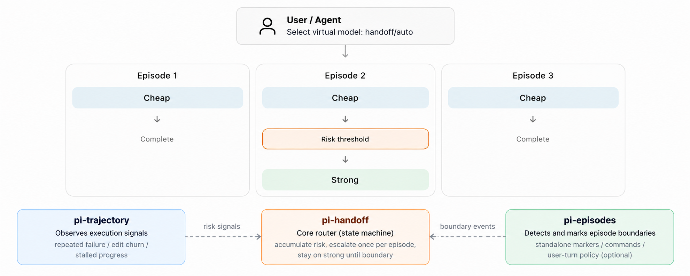

# pi-handoff — Trajectory-triggered Model Escalation for [pi](https://github.com/earendil-works/pi)

A collection of pi extensions that runs a persistent agent **cheap-first**:
every task episode starts on a configured cheap model; observable execution
difficulty (repeated failures, edit churn, stalled progress) accumulates as
trajectory risk; when the threshold `θ` is crossed, the router latches **once**
to a strong model for the rest of the episode. At an explicit episode boundary
the lock is released, risk resets, and the next episode starts on cheap again —
no manual model selection anywhere in the workflow.



## Components

| Extension | Role |
|---|---|
| [`pi-handoff`](extensions/pi-handoff/) | Core router. Registers the `handoff/auto` virtual model, owns the `CHEAP → STRONG_LOCKED` state machine, accumulates weighted risk, escalates at `R_t ≥ θ`, releases at boundaries. The only component that dispatches models. |
| [`pi-trajectory`](extensions/pi-trajectory/) | Execution signal observer. Emits `repeated_failure` / `edit_churn` / `stalled_progress` from tool results — no LLM calls, never touches model selection. |
| [`pi-episodes`](extensions/pi-episodes/) | Boundary controller. Explicit `[episode:next]` markers and `/episode` commands; persists per-branch episode identity that the router reconciles against on every request. |
| [`packages/shared`](packages/shared/) | Event/data contracts shared by the three extensions. |

Routing state is persisted on the session branch (survives reloads, `/resume`,
branch navigation); handoff is full-context — no summarization or transcript
rewriting. Token/cost accounting is covered by the standalone
[`pitok`](pitok/) session monitor.

## Quick start

**1. Prerequisites:** `pi` CLI installed, provider credentials configured.

**2. Configure the model pair** (required, no defaults):

```bash
export PI_HANDOFF_CHEAP="<provider/cheap-model-id>"
export PI_HANDOFF_STRONG="<provider/strong-model-id>"
# optional: PI_HANDOFF_THRESHOLD=4   PI_HANDOFF_WEIGHTS="1,1,1"
```

or via `--handoff-cheap` / `--handoff-strong` / `--handoff-threshold`, or in
`extensions/pi-handoff/handoff.config.json` (see the `.example` file).
Precedence: flag > env > file > defaults.

**3. Start pi on the handoff virtual model:**

```bash
./start.sh   # loads the extensions and runs pi --model handoff/auto
# equivalent manual form:
pi -e ./extensions/pi-trajectory/index.ts \
   -e ./extensions/pi-episodes/index.ts \
   -e ./extensions/pi-handoff/index.ts \
   --model handoff/auto
```

`start.sh` also loads `extensions/gondolin` (VM tool-routing sandbox, needs
QEMU) — drop that line for a clean handoff demo.

## In-session

| Input | Effect |
|---|---|
| `/handoff status` | Phase, risk vs θ, episode, escalation count |
| `/handoff config` | Resolved configuration |
| `/episode next` (alias: `reset`) | End episode → strong lock released, risk reset |
| `/episode status` | Current episode + boundary counts |
| `[episode:next]` (standalone message) | Consumed without an agent run — zero tokens |
| `/trajectory status` | Windows, totals, recent risk timeline |
| `/trajectory export [PATH]` | Full timeline as JSONL |

Footer status shows e.g. `handoff: CHEAP r=2/4 ep-1`. Optional:
`PI_EPISODES_USER_TURN=1` also starts a new episode after a settled run
followed by a new user task (off by default — benchmark runs use explicit
boundaries).

## Tests

```bash
npm test                                    # deterministic suites (mocked pi runtime)
npm run typecheck                           # tsc --noEmit
uv run pytest -v test/test_pitok_and_eval.py
python3 reset_benchmark.py                  # restore benchmark tasks to failing state
```

## Plan & reports

- [Primary Plan](reports/primary-plan.md) — original project plan: positioning, core policy, evaluation design
- [Early Test Report](reports/handoff-smoke.md) — hardening pass + live Cheap → Strong → Cheap smoke evidence
